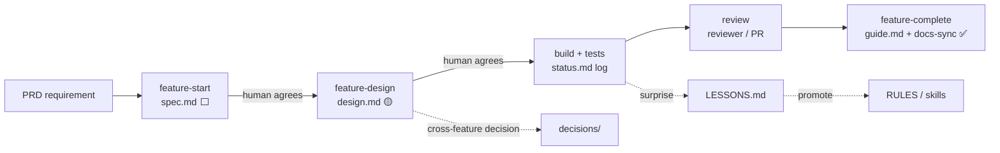

# Docs — map, lifecycle, update matrix

> How documentation is organised and **when each doc must be updated**. Agents: this is the contract
> behind Rule 02 ("docs are part of done") and Rule 03 ("single source of truth").

## Map

```
docs/
├── README.md                 ← you are here
├── PROJECT_STATUS.md         ← INDEX — start every task here
├── product/
│   └── PRD.md                ← WHAT & WHY: goals, non-goals, requirements, milestones
├── architecture/
│   ├── HLD.md                ← system shape: context, components, flows, deployment, quality attributes
│   ├── LLD.md                ← cross-cutting internals: module map, layering, patterns, errors, config
│   ├── schema.md             ← canonical data model + migration log
│   ├── api.md                ← canonical interfaces: endpoints, events, contracts
│   └── diagrams/             ← exported/large diagrams (prefer inline mermaid)
├── features/
│   ├── _TEMPLATE/            ← copied by `make feature name=<x>`
│   └── <feature>/
│       ├── spec.md           ← WHAT — the contract (goal, scope, ACs)        · stable once agreed
│       ├── design.md         ← HOW — feature HLD + LLD, alternatives, decisions · agreed before build
│       ├── status.md         ← PROGRESS — resume-here, checklist, short log  · updated every session
│       └── guide.md          ← AS-BUILT — how it actually works, file map     · written on completion
├── decisions/                ← ADRs: cross-feature / hard-to-reverse decisions
├── reference/                ← glossary, conventions, domain references
├── operations/               ← runbook, deployment, environments, incidents
├── plans/                    ← dated implementation plans (working docs, may go stale)
├── LESSONS.md                ← lessons learned → promoted into rules/skills
└── CHANGELOG.md              ← user-visible changes (Keep a Changelog)
```

## Feature lifecycle



**Status legend** (used in `status.md` and `PROJECT_STATUS.md`):
`⬜ not started` · `🟡 in progress` · `✅ done` · `⛔ blocked` · `🅿️ deferred` · `♻️ superseded`

## Update matrix

Every change walks this table (the `docs-sync` skill). Update **in the same change** as the code.

| When you… | Update | Notes |
|---|---|---|
| Start a feature | `features/<f>/` (scaffold) + `PROJECT_STATUS.md` row | `make feature name=<f>` |
| Change scope / acceptance criteria | `features/<f>/spec.md` | contract — human approves; note it in status log |
| Decide how a feature is built | `features/<f>/design.md` | + decision-log row |
| Make any progress | `features/<f>/status.md` | rewrite Resume here; ≤ 8-line log entry |
| Finish a feature | `guide.md`, `status.md` ✅, `PROJECT_STATUS.md` ✅, `CHANGELOG.md` | `feature-complete` workflow |
| Add/alter tables, columns, indexes, migrations | `architecture/schema.md` | incl. migration log row |
| Add/alter endpoints, events, payloads, CLI | `architecture/api.md` | |
| Add a component, service, queue, external dependency | `architecture/HLD.md` | + ADR if a real choice was made |
| Introduce a cross-cutting pattern / module / config / error model | `architecture/LLD.md` | |
| Add an env var | `.env.example` + `operations/deployment.md` | |
| Change deploy / ops steps, fix an incident | `operations/runbook.md` / `deployment.md` | |
| Make a cross-feature or hard-to-reverse decision | `decisions/NNNN-*.md` | `make adr title=…` |
| Hit a non-obvious failure / get corrected | `LESSONS.md` (+ promotion) | `lesson-capture` skill |
| Change stack, commands, layout | `AGENTS.md §1` | |
| Learn a new domain term | `reference/glossary.md` | |
| Ship anything user-visible | `CHANGELOG.md` `[Unreleased]` | |

## Writing rules

- **Link, don't copy.** Feature docs link `schema.md#table` instead of restating columns.
- **Real paths and names.** `src/auth/service.py::login` beats "the auth service".
- **Diagrams as mermaid** in the doc they explain; large ones in `architecture/diagrams/`.
- **Dates as `YYYY-MM-DD`.** Every living doc carries `Last updated`.
- **Short beats complete.** If a section doesn't apply, write "N/A — <why>" and move on.
- `make docs-check` enforces structure, index ↔ status consistency, staleness, and relative links.
