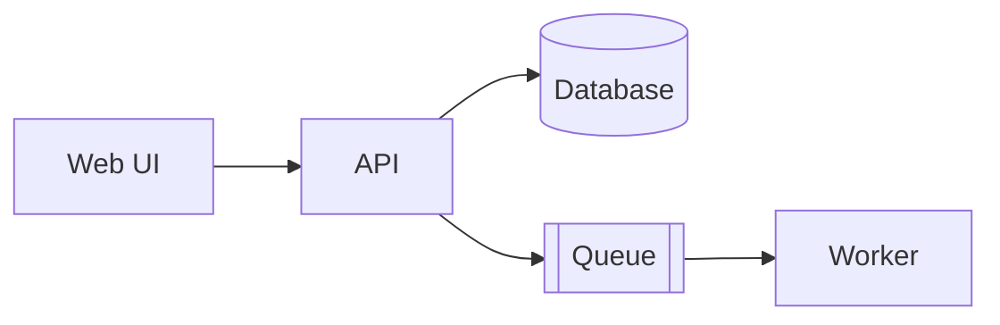

# {{PROJECT_NAME}} — High-Level Design

> The **shape** of the system: what the parts are, how they talk, where they run. Update when a component,
> service, datastore, queue, or external dependency is added or removed. Detail → `LLD.md`.

**Last updated:** YYYY-MM-DD · **Related:** [PRD](../product/PRD.md) · [LLD](./LLD.md) · [ADRs](../decisions/)

## 1. Context

Who/what interacts with the system (users, external systems).

```mermaid
flowchart LR
  user([User]) --> sys[{{PROJECT_NAME}}]
  sys --> ext1[(External service)]
```

## 2. Components / containers



| Component | Tech | Responsibility | Owns data | ADR |
|---|---|---|---|---|
| … | … | … | … | ADR-0002 |

## 3. Key flows

Main end-to-end flows (sequence diagrams or numbered steps). Feature-specific flows live in the feature's `design.md`.

## 4. Deployment

Environments, hosting, network boundaries. Detail: `../operations/deployment.md`.

## 5. Quality attributes

How the design meets the NFRs (scalability, availability, security, cost) — link NFR ids.

## 6. Security model

Trust boundaries, authN/authZ approach, secrets management, data classification.

## 7. Tech stack

| Layer | Choice | Why (ADR) |
|---|---|---|

## 8. Known constraints & future direction
