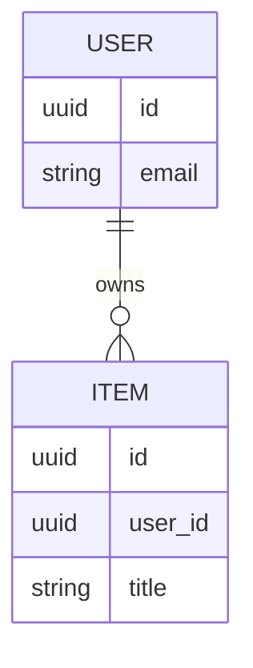

# {{PROJECT_NAME}} — Data Model (canonical)

> The single source of truth for persistent data. Feature docs **link here** instead of restating columns.
> Update in the same change as any migration.

**Last updated:** YYYY-MM-DD

## Conventions

- Naming: `snake_case`, plural table names, `id` primary key (type: …).
- Timestamps: `created_at`, `updated_at` (UTC). Soft delete: `deleted_at` (if used).
- Migrations: tool …, always reversible, reviewed before apply.

## ER diagram

## Tables

### `users`

| Column | Type | Null | Default | Notes |
|---|---|---|---|---|
| `id` | uuid | no | gen | PK |

Indexes: … · Constraints: … · Owned by feature: …

## Migration log

| Date | Migration id | Change | Feature |
|---|---|---|---|
