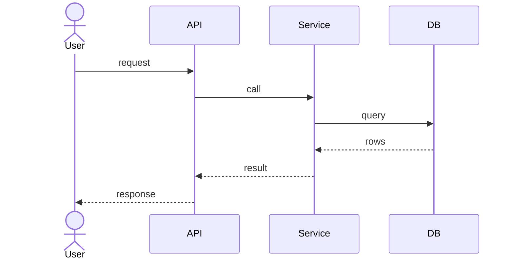

# Feature: <name> — Design (HOW)

> Feature-level **HLD + LLD**. Agreed with the human before implementation; kept true as the build evolves
> (deviations go in the decision log). Spec: [spec.md](./spec.md)

**Status:** draft · **Author:** <agent/person> · **Last updated:** YYYY-MM-DD

## 1. Summary

3–5 lines: the approach in plain words.

## 2. High-level design

Where this sits in the system (link `../../architecture/HLD.md`) and the main flow.

## 3. Low-level design

### 3.1 Files / modules

| Path | New / changed | Responsibility |
|---|---|---|
| `src/…` | new | … |

### 3.2 Data model delta

Tables/columns/indexes added or changed (canonical doc updated when built: `schema.md`).

### 3.3 Interfaces

Endpoints / events / function signatures with request/response shapes and error codes
(canonical doc updated when built: `api.md`).

### 3.4 Logic & algorithms

Key steps, state transitions, edge cases.

### 3.5 Error handling & idempotency

What fails, how it's detected, retried, surfaced. What happens on re-run.

### 3.6 Security & privacy

AuthN/Z checks, input validation, secrets, PII.

### 3.7 Config & observability

New env vars / flags; logs, metrics, alerts.

## 4. Alternatives considered

| Option | Pros | Cons | Why not |
|---|---|---|---|
| … | … | … | … |

## 5. Test strategy

| AC | Test (file::name) | Type |
|---|---|---|
| AC-1 | `tests/…::test_…` | unit / integration / e2e / manual |

## 6. Rollout & migration

Migrations, backfills, flags, backwards compatibility, rollback plan.

## 7. Risks

## 8. Decision log

> Feature-local decisions, newest first. Cross-feature → ADR in `docs/decisions/`.

| Date | Decision | Why | Alternatives |
|---|---|---|---|
| YYYY-MM-DD | … | … | … |

## 9. Open questions

- [ ] …
